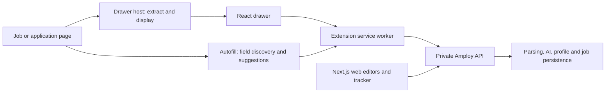

# Amploy: feature and logic analysis

## Evidence boundary

The selected targets were `https://amploy.app/` and the official Chrome Web Store extension `fbnenabmljienoifjpmjfojidillcdii`. After public internet access was enabled, the website, listing, and Google's extension delivery service returned HTTP 200. The downloaded CRX manifest declares **2.5.2**. Its SHA-256 is `8a59543292758f6053d4f6d31a8de7da4f590fca1ea10f6b0f54eddf04a407d7`.

JavaScript was parsed as inert source, not executed to sign in, make authenticated requests, or submit applications. This is static client-side analysis, not a decompilation of private server code. No native binary or Ghidra was required.

REA's primary extension observation is `ev_b8df56eb96c5ea3ea3908b740c2eb33c6ba5e7de38b11b47e77e882a3ae524d0`. The first pass inventoried nine relevant files and parsed five JavaScript files with no syntax parse failures. The large UI vendor bundle exhausted the default 1 GiB analyzer heap. A separate attempt with a 3 GiB heap reached its 180-second per-source deadline; that dependency remains incompletely analyzed. Semantic graph coverage is partial; a completed summary view does not imply complete source or runtime coverage. Exact limits remain in [extension-summary.json](evidence/extension-summary.json).

The initial website observation `ev_ff8c4ae805ab0bf4fff97f8d107771638876040753b5df057026e16d03d89379` covers four explicitly selected public marketing/demo/pricing chunks. Additional application chunks were inspected separately. These are public downloaded assets even when a route's source directory is named `(protected)`; no account authentication was bypassed.

The actual app-screen analysis is `ev_38b002697afeb88689184d1d78b4eebcaa537c2080f0ad5027adbab11053b49a` (five selected jobs/resume/logins/layout/streaming chunks), and the application-profile analysis is `ev_7a7d808107f69532086d5154cfcb5980f6e52aadeb27294c37aab61990f3f40c` (one chunk). Both have zero syntax parse failures and partial semantic coverage. See [website findings](website-findings.md) and [extension findings](extension-findings.md) for direct-source references. Paths in those reports refer to the preserved cloud research directory, not source shipped in this reconstruction.

## Architecture

The extension manifest registers a background service worker, a drawer host on matching pages, and an autofill script in frames. The service worker handles messages, tokens, API calls, and temporary application-answer memory. Public web assets implement the tracker, resume editor, application details, login manager, and Firebase sign-in UI.

## Features and implementation

| Feature | Observed client logic | Unavailable logic | Independent replacement |
|---|---|---|---|
| Capture a job | JSON-LD `JobPosting`, site-specific selectors, fallback main content; editable title/company/URL/description | Final semantic parsing at `POST /jobs/parse` | User-triggered structured-data/text capture and manual correction |
| Track applications | Job table, search title/company, filter, status updates, materials and date indicators | Backend schema, database, access rules | Local SQLite, searchable jobs, status, notes, document associations |
| Match a job | Calls `POST /jobs/{id}/match`; renders score, summary, strengths/gaps; display thresholds 70/50 | Score computation, model, prompts, weighting | Clearly labelled keyword overlap |
| Tailor resume | Calls `/jobs/{id}/generate/resume`; edits/downloads returned resume data | Generation prompt/model and PDF rendering | Editable factual text assembled from user profile, print-to-PDF |
| Cover letter | Calls `/jobs/{id}/generate/cover-letter`; edits/downloads | Model and generation rules | Role/company-specific template using supplied summary |
| Resume/profile | Public app imports PDF, edits structured resume, supports polish and downloads | Parsing/polish pipeline | Local PDF/DOCX/TXT extraction and editable profile text |
| Application details | Separately saves phone, links, address, authorization/sponsorship, start date, salary | Storage and validation implementation | Explicit optional fields; no eligibility inference |
| Autofill | Discovers visible fields; sends sanitized context and UIDs to `/autofill/analyze`; Tab accepts into empty field | Server semantic field mapping and free-text answer generation | Reviewed explicit contact-field mappings; skips existing values/passwords; never submits |
| Answer memory | Per-tab/origin answers, four-hour expiry, 80-entry bound; scored label/name reuse | Remote answers | Not reproduced in initial companion; saved profile is reusable |
| Site logins | Lookup/save and reveal/copy; separate credential form fill | Server encryption and storage | Browser-encrypted manual vault, no extension password access |
| Sign-in/billing | Firebase tokens, quota display, refresh/retry, pricing UI | Entitlements, billing enforcement | No accounts, billing, quotas, or telemetry in single-user app |
| Drawer | Injected isolated UI with docking, resizing, persistence | No material hidden algorithm | Smaller explicit-action popup |

## Important recovered flows

**Job capture:** host extracts page material → `parse_job` message → service worker sends page text, URL, and sanitized HTML to the remote parser → user reviews parsed fields → save. Extracted page text is evidence for capture, not proof of the backend's interpretation.

**Autofill:** visible field inventory → collect labels and sanitized nearby HTML → reuse known answers → remote suggestions for unresolved fields → focused empty field receives suggestion only after user action. Normal suggestion inventory excludes passwords, selects, checkbox/radio inputs, and uploads. The personal extension is narrower and only uses values explicitly supplied in the profile.

**Document generation:** choose saved job → generation endpoint uses account/job context → response stored as `resume_json` or `cover_letter_json` → web editor/download. The client call does not reveal how an LLM was prompted. The new implementation's deterministic templates must not be described as the recovered AI engine.

**Application status:** saved → applied → interviewing → offered/rejected are the original status identifiers. The rebuild presents Saved/Applied/Interview/Offer/Rejected. It does not infer successful submission from a click; the user controls status.

## What this does not establish

- Full backend source, authentication rules, model prompts, accuracy, or encrypted credential handling.
- That the original app's advertised features work on every job portal.
- Complete static call graphs across dynamic expressions or vendor dependencies.
- Runtime behavior of the original authenticated product; no account was used.
- Feature parity for billing, AI prose, PDF layout, answer memory, rich form widgets, or injected drawer behavior.

The reconstruction's tests validate its own behavior. They do not prove that it matches every behavior of the original service.

An independently written optional OpenAI-compatible adapter adds AI resume/letter drafting when the user supplies their own key and model. It does not reproduce Amploy's private prompts, models, scoring, or quality controls. The default remains local deterministic drafting; only the adapter protocol was tested locally, not a real hosted model response.
